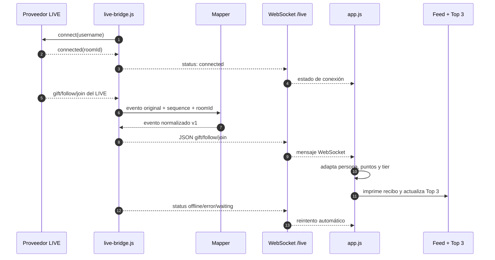
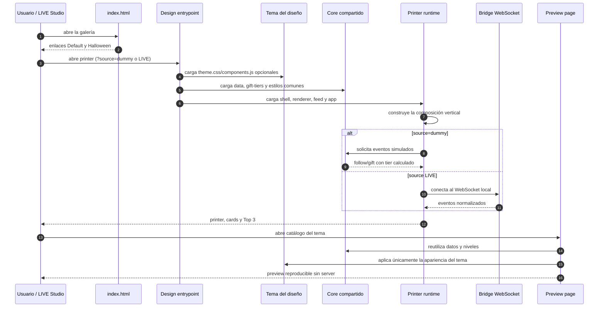

# GiftWallLive

GiftWallLive será una página web visual para usar como contenido principal de un TikTok LIVE. Representará los regalos de los espectadores en una cinta digital animada y mostrará los tres envíos de regalos más valiosos del LIVE.

## Estado

Prototipo local con un recibo animado que mezcla regalos, nuevos seguidores y espectadores que se unen simulados. Incluye un puente experimental opcional que lee un LIVE público y publica eventos normalizados por WebSocket.

## Ejecución local

Abre `index.html` directamente en un navegador moderno: ahora es la galería para elegir diseño. Usa **Try the demo** para datos simulados o **Open LIVE printer** para la fuente de transmisión. No requiere instalaciones ni servidor para explorar los diseños.

Para probar eventos reales, instala e inicia el puente desde `server/`:

```bash
npm install
npm start -- nombre_del_creador
```

El estado queda disponible en `http://127.0.0.1:8081/health` y los eventos en `ws://127.0.0.1:8081/live`.

Cada printer abre el modo LIVE por defecto y permanece vacío hasta recibir actividad real:

- Printer: `designs/printer/index.html`
- Halloween: `designs/halloween/index.html`
- Radio: `designs/radio/index.html`

Añade `?source=dummy` a cualquiera para ejecutar el loop de demostración. El modo LIVE nunca mezcla ni sustituye eventos reales con datos simulados. Los enlaces antiguos a `index.html?source=dummy` o `index.html?source=live` redirigen a Default conservando los parámetros. El enlace raíz sin parámetros ahora muestra la galería; si lo usabas en LIVE Studio, sustitúyelo por la ruta directa de Default.

## Estructura

```text
GiftWallLive/
├── index.html
├── designs/
│   ├── README.md
│   ├── printer/
│   │   └── index.html
│   └── halloween/
│       ├── index.html
│       ├── components.js
│       └── theme.css
├── css/
│   ├── README.md
│   ├── core/
│   │   └── base.css
│   ├── components/
│   │   ├── gift-showcase.css
│   │   ├── printer-components.css
│   │   ├── printer.css
│   │   └── top-three.css
│   └── pages/
│       ├── collection-preview.css
│       └── gallery.css
├── js/
│   ├── README.md
│   ├── core/
│   │   ├── data.js
│   │   └── gift-tiers.js
│   ├── live/
│   │   └── live-events.js
│   ├── printer/
│   │   ├── app.js
│   │   ├── feed.js
│   │   ├── printer-components.js
│   │   └── printer-shell.js
│   └── ui/
│       ├── collection-preview.js
│       ├── gallery.js
│       └── top-three.js
├── prototypes/
│   └── printer/
│       └── printer-components.html
├── server/
│   ├── domain/
│   │   └── live-event.js
│   ├── mappers/
│   │   └── piratetok-mapper.js
│   ├── providers/
│   │   └── piratetok-provider.js
│   ├── spotify/
│   │   ├── client.js
│   │   ├── integration.js
│   │   └── requests.js
│   ├── tests/
│   │   └── spotify.test.js
│   ├── .env.example
│   ├── live-bridge.js
│   └── package.json
├── tests/
│   └── legacy-effects/
├── AGENTS.md
├── README.md
├── .gitignore
├── .agents/
│   └── skills/
│       ├── frontend-design/
│       │   ├── SKILL.md
│       │   └── LICENSE.txt
│       └── giftwall-design/
│           └── SKILL.md
└── assets/
    ├── images/
    └── sounds/
```

### Aplicación principal

`index.html` es únicamente el selector. Cada página en `designs/` carga el mismo escenario de `js/printer/printer-shell.js` y los módulos comunes separados por responsabilidad. Los estilos compartidos viven en `css/core/`, `css/components/` y `css/pages/`; Halloween añade su renderer y estilos sin copiar datos, rangos, ranking, WebSocket ni animación de avance. Los dos diseños tienen un `preview.html` que reutiliza el catálogo común; solo cambia el arte y el renderer.

Halloween incluye diez variantes (seguidor y nueve tiers), monedas redondas, podio de retratos arqueados y una prensa de hierro violeta y cobre. Las cards progresan desde un registro de vela hasta seis escenas cinematográficas ilustradas de Epic a Cosmic. Reutilizan los mismos avatares, regalos, rangos y datos; Default no cambia.

Abre [el catálogo Halloween](designs/halloween/preview.html) para comparar todos los niveles, repetir una entrada o pausar el movimiento, sin WebSocket ni servidor. El catálogo usa los eventos de `js/core/data.js`, no un segundo juego de datos. Su página carga el CSS de catálogo desde `css/pages/collection-preview.css` y el comportamiento desde `js/ui/collection-preview.js`.

Los seis fondos originales se guardan en `assets/images/halloween/`: WebP de 1024 × 1536 (aproximadamente 1.6 MB en total), generados con imagegen y con prompts/procedencia documentados en su README. La profundidad es una composición 2.5D de arte, CSS y SVG, no modelos 3D. Los nombres, avatares y regalos permanecen en HTML a resolución nativa.

Cada nivel premium tiene una acción propia: enjambre, caída de reliquia con fragmentos, aparición espectral, gotas de rubí, llegada de vehículo nocturno y apertura de la catedral del eclipse. Después queda movimiento ambiental acotado; solo las tres cards más cercanas del recibo animan. `prefers-reduced-motion` mantiene las escenas estáticas y todos los datos visibles. No se incorporan sonidos, flashes rápidos ni cambios en el valor de los regalos.

Véase `designs/README.md` para añadir otro diseño. Las ideas futuras y alternativas al printer se conservan en `.local/`, ignorado por Git; no forman parte del sitio publicado.

### Prototipos visuales

La carpeta `prototypes/` contiene páginas independientes para definir y aprobar partes de la interfaz antes de incorporarlas a la aplicación principal. Se pueden abrir directamente en el navegador y no necesitan un servidor local.

- [`printer/printer-components.html`](prototypes/printer/printer-components.html): laboratorio para diseñar cada componente del printer por separado antes de reutilizarlo en el loop principal.

El catálogo se concentra únicamente en la estructura y presentación visual de cada componente. No asigna rangos de puntos, porque esa decisión pertenece a la lógica de la aplicación.

### Diseños conservados

La versión visual experimental anterior se conserva en `tests/legacy-effects/` para poder recuperar sus efectos en el futuro. No forma parte del diseño principal actual.

### Puente de eventos

La carpeta `server/` contiene la integración experimental con proveedores de LIVE:

- `providers/` recibe los eventos originales de cada proveedor.
- `mappers/` convierte esos datos al contrato común de GiftWallLive.
- `domain/live-event.js` define la forma estable que recibe el frontend.
- `live-bridge.js` publica estados y eventos normalizados en `/live` (`gift`, `follow`, `join` y `chat`).
- `js/live/live-events.js` consume ese contrato y reintenta la conexión automáticamente.

El printer no debe depender del formato particular de PirateTok. Un proveedor futuro, como TikFinity, tendrá su propio provider y mapper, pero emitirá el mismo contrato.

### Base de Spotify

La carpeta `server/spotify/` contiene la integración preparada para Spotify sin exponer tokens en el navegador ni añadir otra dependencia:

- `integration.js` lee el Client ID, redirect URI, scopes y ventana de solicitud desde variables de entorno.
- `client.js` e `integration.js` preparan OAuth PKCE y las rutas locales `/spotify/login`, `/spotify/callback`, `/spotify/status`, `/spotify/player` y `/spotify/queue`.
- `requests.js` reconoce una búsqueda libre como `play: Sueños de Medianoche Neon Luna`; opcionalmente acepta `play: "Canción" | "Artista"` o el separador `-` para afinar resultados.
- `requests.js` clasifica regalos elegibles: 31–100 normal, 101–500 prioritario y 501+ superprioritario.
- `requests.js` abre una ventana de 60 segundos después de un regalo elegible, valida que el chat pertenezca al mismo usuario y ordena la cola por prioridad con FIFO dentro de cada nivel.

Para activar la autorización, copia `server/.env.example` como `.env`, completa `SPOTIFY_CLIENT_ID`, registra exactamente `http://127.0.0.1:8081/spotify/callback` en el panel de Spotify y abre `http://127.0.0.1:8081/spotify/login` con el puente iniciado. Los tokens se mantienen solo en memoria durante esta primera base; no se escriben en el repositorio. La cola interna queda separada del reproductor para que el siguiente paso pueda despachar canciones respetando prioridades sin depender de un orden que Spotify no garantiza.

Cuando Spotify está autorizado, la canción actual terminó, la cola real está vacía y no hay solicitudes pendientes, `server/spotify/fallback.js` elige una canción aleatoria de la lista predeterminada de BTS y BLACKPINK e intenta iniciarla en el dispositivo Spotify activo. Una pausa manual no dispara otra canción. La lista y el intervalo de comprobación son configurables en ese archivo.

### Flujo de eventos LIVE

El server mantiene la conexión con el proveedor y entrega al navegador un contrato único. El navegador nunca consume directamente el formato específico de PirateTok u otro proveedor.



El endpoint `GET /health` solo expone el estado actual para diagnóstico. Los eventos viajan por `ws://127.0.0.1:8081/live`; si el proveedor se desconecta, el bridge publica el estado y programa una reconexión.

### Flujo de diseños y previews

Los diseños comparten motor, datos y estilos base. La carpeta del diseño solo decide el tema y, cuando hace falta, su renderer visual.



En la fuente Enlace se recomienda usar directamente `designs/printer/index.html` o `designs/halloween/index.html`; la galería raíz es solo un selector visual.

La radio mantiene su propio layout vertical en `designs/radio/`. Su PNG contiene únicamente el cuerpo de la impresora; `designs/radio/js/ticket-components.js` mapea las variantes visuales (`music`, `gift`, `gift-special` y `join`), mientras `tickets.js` solo controla datos, cola y animación. Los regalos de 1 a 30 monedas usan la tarjeta básica; desde 31 monedas usan la tarjeta especial. El printer conserva como máximo las 10 impresiones más recientes y elimina la más antigua cuando llega una nueva, evitando que el DOM crezca indefinidamente. El demo añade una impresión cada cuatro segundos y expone `window.radioTickets.add(ticket)` para conectar después los eventos reales sin cambiar la composición.

La radio solo activa datos simulados con `designs/radio/index.html?source=dummy`. Sin ese parámetro permanece visualmente disponible, pero no inserta cola, tarjetas ni animaciones demo; queda preparada para recibir eventos reales. La cola visual conserva como máximo cinco solicitudes y el printer diez impresiones.

En modo LIVE, `designs/radio/js/live-bridge.js` consume `ws://127.0.0.1:8081/live`, convierte regalos, follows, entradas y solicitudes musicales aceptadas en sus componentes visuales y reintenta la conexión si el puente se reinicia. La URL se puede cambiar con `?socket=ws://host:puerto/live`.

Las reacciones de la mascota siguen cuatro reglas: música activa usa `listening`, un regalo usa `happy`, un follow usa `greeting` y, cuando no hay actividad, vuelve a `idle`. El modo dummy deja la mascota en `idle` y expone esas acciones desde `window.radioMascotDemo` para probarlas manualmente.

### Instrucciones para IA

`AGENTS.md` contiene las instrucciones permanentes para trabajar con asistentes de IA dentro de este repositorio.

La skill externa `frontend-design` guía la dirección artística y la implementación de interfaces distintivas. La skill local `giftwall-design` añade los criterios propios de GiftWallLive. Las decisiones generales del proyecto permanecen en `AGENTS.md`.

## Principios

- Una sola página web vertical.
- Lienzo maestro 9:16 con salida objetivo en 720 × 1280 y 1080 × 1920.
- Una única composición móvil de referencia de 464 px de ancho. El tamaño raíz se calcula como ancho del escenario / 29; tarjetas, avatares, texto, bordes y efectos usan `rem` para crecer juntos. No se amplía una captura ni se usa zoom de la fuente.
- En ventanas anchas se centra el escenario 9:16 y el sobrante se rellena con fondo. En móviles más altos se utiliza todo el ancho y la altura disponible. No hay una variante de escritorio ni un límite aislado de 360/720 px para el printer.
- Tres columnas alineadas bajo la zona segura: niveles compactos a la izquierda, printer prioritario en el centro y Top 3 apilado a la derecha. Las columnas laterales miden 3.6 y 5.25 rem; el printer recibe el espacio restante.
- Zona segura superior adaptable para barras de estado, notch y Dynamic Island en móviles.
- La composición compartida usa 15 px de espacio superior en Default y Halloween; `env(safe-area-inset-top)` puede aumentarlo automáticamente cuando el dispositivo lo informa.
- HTML, CSS y JavaScript nativos.
- Datos y regalos simulados durante la primera versión.
- Sin frameworks de interfaz, base de datos ni autenticación mientras no sean necesarios.

### Fuente Enlace en LIVE Studio

Copia la URL directa de un printer en `designs/`, no la dirección de la galería.

Usa una resolución de fuente de **1080 × 1920** para un lienzo vertical de la misma proporción. Para pruebas simuladas añade `?source=dummy` a la URL. El navegador dibuja los componentes a esa resolución: las medidas son 1.5 veces las de 720 × 1280, conservando su proporción. No compenses el diseño cambiando solo el ancho a 400 px ni estirando los ejes por separado.

La previsualización de LIVE Studio puede mostrar la fuente reducida. Esa reducción no cambia la composición interna. Recarga la fuente después de publicar cambios; la validación en LIVE Studio se realiza sobre la versión publicada, no sobre los archivos locales sin publicar.

## Componentes actuales

- Top Gifts compacto con foto, usuario, cantidad, icono y valor total; oro, platino y cobre distinguen visualmente cada posición. Las tres posiciones permanecen visibles con valor `0` hasta recibir regalos reales.
- Dirección visual experimental de prensa de coleccionista: acero oscuro, salida térmica iluminada y papel perlado; Top Gifts con placas de oro, platino y cobre.
- Niveles identificados por número, color y rango exacto de monedas; el nombre completo se conserva para accesibilidad. El Top 3 vertical libera altura para el recibo.
- Carcasa térmica con tapa elevada, rejillas, pantalla de estado, control decorativo, rodillo y borde de corte. Los diseños y animaciones de las cards permanecen independientes de la carcasa.
- Recibo continuo que calcula automáticamente cuántos registros necesita para llenar la altura disponible.
- Registro de regalo con avatar, nombre, agradecimiento, cantidad e icono del regalo.
- Registro de seguidor a media altura, sin fotografía.
- Catálogo visual con nueve niveles de regalo: Basic, Featured, Stellar, Epic, Legendary, Mythic, Celestial, Primordial y Cosmic.
- Loop de impresión con datos simulados que recorre New Follower y los nueve componentes visuales.
- `js/printer/printer-components.js`: genera el HTML de cada componente reutilizable del printer.
- `css/components/printer-components.css`: contiene su presentación, jerarquía visual y animaciones.
- `assets/sounds/audio-printer.mp3`: sonido compartido de impresión. Se reproduce una vez por tanda mientras el audio anterior termina, sin superponer sonidos cuando llegan varios eventos juntos.
- La carcasa del printer y el escenario se dibujan con CSS. La colección progresa desde tinta monocroma hasta acabados iridiscentes, oro, cristal, luz solar, mineral y espacio profundo. Se respeta `prefers-reduced-motion`.
- `assets/images/printer-frame-obsidian.png`: marco de la versión anterior conservado como recurso; no se muestra en la propuesta visual actual.
- `assets/images/printer-frame.png`: versión arcade anterior conservada como referencia visual.
- `assets/images/obsidian-gallery-bg.png`: fondo de la galería anterior conservado como recurso.

En los datos simulados, `gift.points` representa el valor unitario del regalo. El aporte total de cada envío se calcula como `gift.points × gift.amount`; por ejemplo, veinte regalos de 1 punto producen un envío de 20 puntos.

## Rangos de regalos

`js/core/gift-tiers.js` es la fuente única para clasificar regalos y generar los rangos visibles en `Gift collection`. La clasificación utiliza el aporte total de la acción (`valor unitario × cantidad`), por lo que enviar varias unidades sí puede elevar el componente visual. Un regalo de 1 punto enviado 20 veces utiliza Stellar.

La escala visual grande comienza en **Stellar**, desde 10 monedas. El panel muestra el símbolo de moneda junto a cada rango y la leyenda `10+ coins → larger cards` para que el público entienda la progresión. Las entradas se separan así: `join` muestra el banner de bienvenida, `follow` usa Basic, las donaciones de 1–9 usan Featured y desde 10 monedas se muestran cards completas.

| Evento o tier | Aporte total de la acción |
| --- | ---: |
| Join | Banner de bienvenida, sin monedas |
| Basic | New follower |
| Featured | 1–9 |
| Stellar | 10–30 |
| Epic | 31–100 |
| Legendary | 101–350 |
| Mythic | 351–499 |
| Celestial | 500–1,500 |
| Primordial | 1,501–4,800 |
| Cosmic | 4,801 o más |

Los datos dummy de `js/core/data.js` solo declaran los puntos y la cantidad. La aplicación obtiene automáticamente el `tier` desde esta configuración antes de imprimir cada evento.
